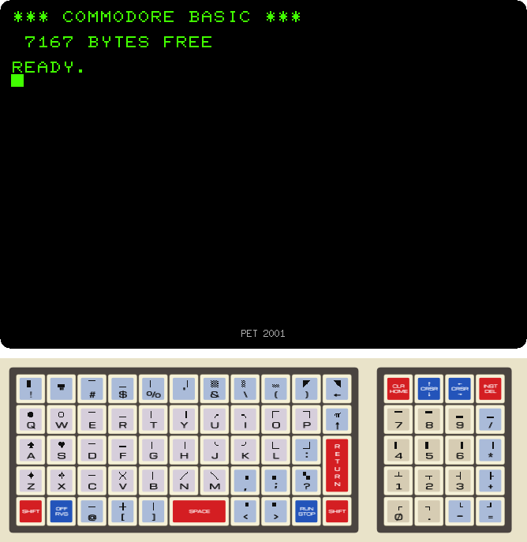
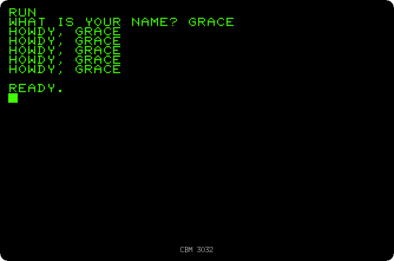
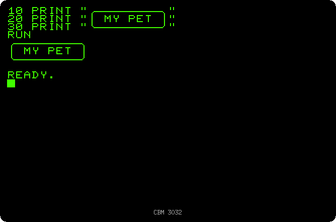
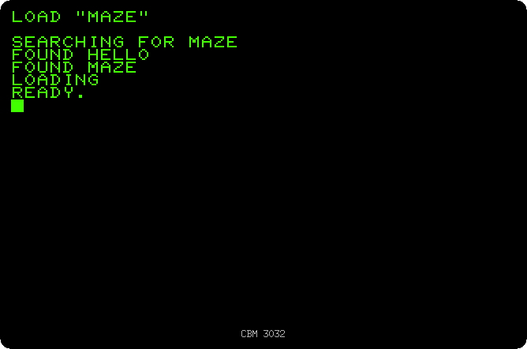
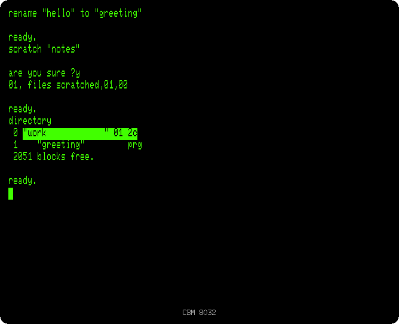
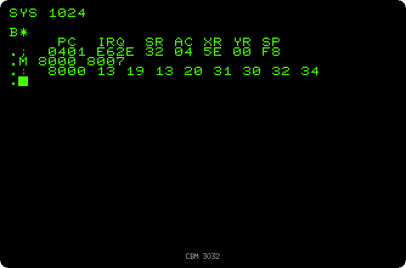
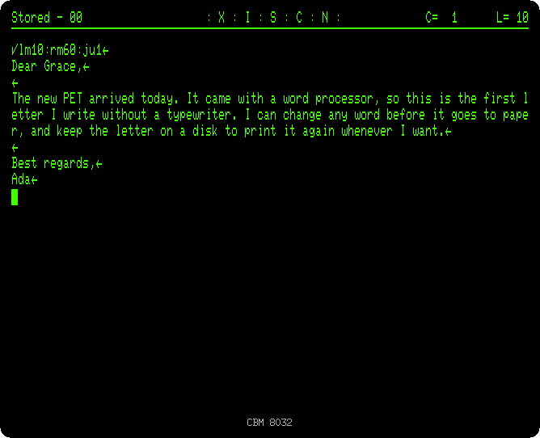
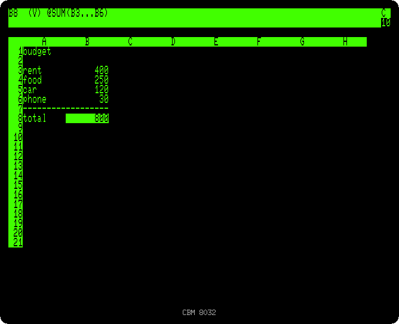

# Things to do with a PET

[Back to the README](../../README.md)

izpet runs the real ROMs of the Commodore PET, so it is a way of finding out
first hand what using one was like: what was on the screen, how the keyboards
were, and how people did their work with them from 1977 into the early
eighties. These pages each take one thing a PET user did then and walk through
it, step by step, with what you will see on the way.

All you need is izpet: the ROMs of every model are inside it.

## First steps

### [Switching on every PET](models.md)

Seven models, from the first PET 2001 with its calculator keyboard to the 80
columns of the CBM 8032: what each one says when it is switched on, how much
memory it leaves to BASIC, and the keyboard it came with.

### [Your first program](first-program.md)

Commands run at once, a program typed, run and listed, a line of it changed
right on the screen, and a program that runs for ever stopped with RUN/STOP.

### [Drawing with the keyboard](drawing.md)

The graphics characters on the keys, typed with SHIFT: a box, text in reverse,
the famous one line maze, and characters written straight into the memory of
the screen.

## Keeping programs

### [Programs on cassette](cassette.md)

The cassette recorder, where most PET owners kept their programs: two
programs saved on a blank tape and one of them loaded back, with the time it
took.

### [The disk drive](disk.md)

The disk commands of BASIC 4 on an 8032 with an 8050: a disk formatted, a
program saved and loaded, a data file written and read, the status of the
drive, and a folder of your computer used as a disk.

## Programming

### [The machine language monitor](monitor.md)

The monitor in the ROM: the registers of the processor, the memory in
hexadecimal, a routine typed byte by byte that fills the screen eight hundred
times faster than BASIC.

## Business

### [Writing a letter with WordPro](wordpro.md)

The word processor of the 8032: a letter typed, its margins and justification
set with a format line, kept on a disk and printed.

### [A budget with VisiCalc](visicalc.md)

The first spreadsheet: a budget with a sum, a cost changed and the total
recalculated at once, the sheet saved on a disk and printed.
