# Three versions of BASIC

[Back to the activities](README.md)

Every PET started in BASIC, and the BASIC was Microsoft's: Commodore licensed
the BASIC Microsoft had written for the 6502 and put it in the ROMs, with
the name of Commodore on the screen. There were three versions in the PETs.
BASIC 1 came with the first PET 2001, and still had many bugs: it could not
use the disk drives at all. BASIC 2 fixed most of them, made the disks work
and added a small machine language monitor. It was put in the PETs that
followed and sold as upgrade ROMs for the first ones. BASIC 4 came with the
4000 and 8000 series, with commands of its own for the disks and a much
faster way of tidying up its memory.

BASIC 2 also brought something nobody at Commodore had asked for: a message
from Microsoft, hidden behind a command that seems to do nothing.

This page goes through the three on a 2001, a 3032 and a 4032: what the same
commands do on each, the hidden message, and how fast each one is. A table
at the end sums them up.

## What you need

Only izpet, started as the three models, each with the same disk image,
`basics.d64`, created the first time:

```bash
go run ./frontend/petebiten -model 2001 -disk basics.d64
go run ./frontend/petebiten -model 3032 -disk basics.d64
go run ./frontend/petebiten -model 4032 -disk basics.d64
```

`-disk` puts the image in the drive 0 of a disk drive on the unit 8.

The three start with the uppercase letters: type the commands as they are
written here, without SHIFT. The page [Switching on every PET](models.md)
has the other models and what they say when switched on.

## BASIC 1

1. **Start the PET 2001.**

   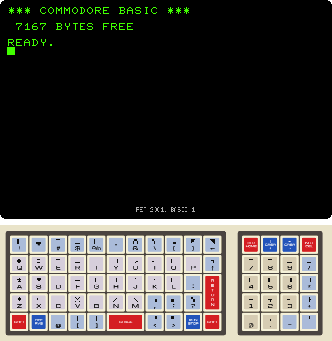

   `*** COMMODORE BASIC ***` is BASIC 1, with 7167 bytes free in the 8 KB of
   this 2001.

2. **Switch to the lowercase letters with `POKE 59468,14`, then type `PRINT
   "Hello World"` with SHIFT only on the H and the W.**

   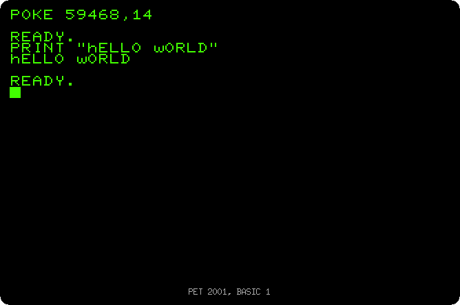

   The PET has two character sets: the one it starts with, with the
   uppercase letters and the graphics characters, and one with lowercase
   letters, chosen with the `POKE`. On the 2001 the lowercase set is the
   other way round: the letters typed without SHIFT are uppercase and the
   ones with SHIFT lowercase, so `Hello World` comes out as `hELLO wORLD`.
   `POKE 59468,12` goes back to the graphics set.

3. **Type `SYS 1024`, then `LOAD "$",8`, and press RUN/STOP, Escape on your
   keyboard, after a few seconds.**

   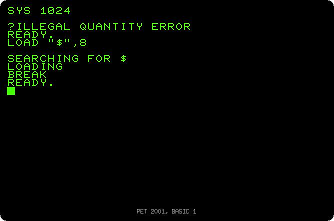

   `SYS` runs machine language at an address. On the later BASICs `SYS 1024`
   enters the monitor, as the next section shows; BASIC 1 has no monitor,
   and answers with an error.

   `LOAD "$",8` asks the disk drive for its directory. BASIC 1 says
   `LOADING` and stays there: its handling of the IEEE-488 bus, the one of
   the disk drives, does not work, and nothing ever comes. RUN/STOP gives
   up, with `BREAK`.

4. **Type `WAIT 6502,1`.** Nothing happens, and nothing ever will: the
   cursor is gone and the PET waits for good. RUN/STOP does not help either,
   only a reset gets it back: Ctrl-F2 in izpet. What this command is about
   is in the next section.

## BASIC 2

5. **Start the CBM 3032.**

   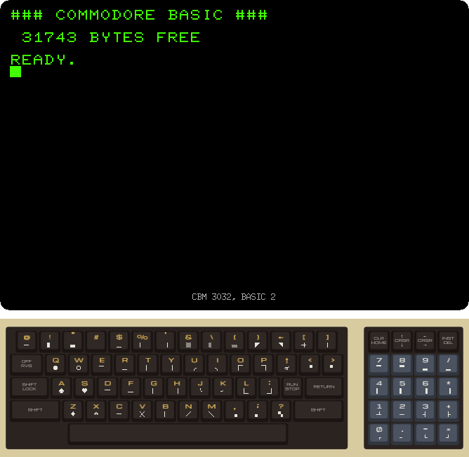

   The banner has `###` where BASIC 1 had `***`: the way to tell the two
   apart at a glance. With 32 KB of memory, BASIC 2 has 31743 bytes free.

6. **Type the same `POKE 59468,14` and `PRINT "Hello World"`.**

   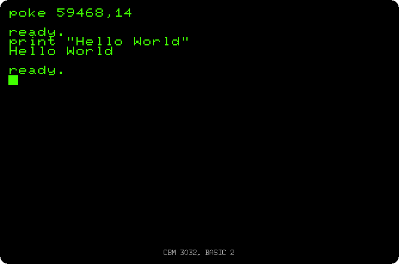

   The letters come out as typed: lowercase without SHIFT, uppercase with
   it, as on every PET after the 2001. The rest of the screen, typed without
   SHIFT, is lowercase now. Go back with `POKE 59468,12`.

7. **Use the disk: format it, save a program, and look at the directory.**

   ```
   OPEN 15,8,15,"N0:BASICS,01":CLOSE 15
   10 PRINT "HELLO"
   SAVE "HELLO",8
   LOAD "$",8
   LIST
   DIRECTORY
   ```

   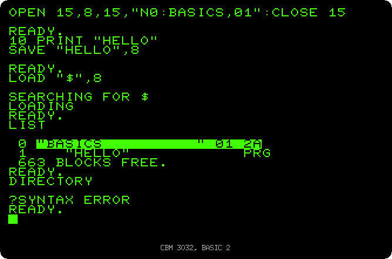

   BASIC 2 has no commands for the disks, only the `,8` of the unit after
   the ones for the cassette, `SAVE` and `LOAD`, and `OPEN`. Anything else is
   a command sent to the drive on its channel 15: `N0:BASICS,01` formats the
   disk in the drive 0, the N of new, with the name `BASICS` and the id
   `01`. The directory is loaded as if it were a program, the one called
   `$`, and seen with `LIST`; it replaces the program in memory.
   `DIRECTORY` is not a command of BASIC 2, so `?SYNTAX ERROR`.

8. **Clear the screen with SHIFT and HOME, and type `SYS 1024`.**

   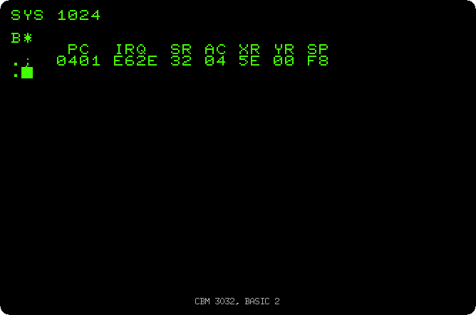

   The monitor: the registers of the processor, and a `.` waiting for a
   command. 1024 is the start of the memory of BASIC, which has a 0 there,
   the BRK instruction of the 6502, and a BRK enters the monitor. `X`
   goes back to BASIC. The page [The machine language
   monitor](monitor.md) has more of it.

9. **Reset with Ctrl-F2, and when BASIC is ready, type `WAIT 6502,1`.**

   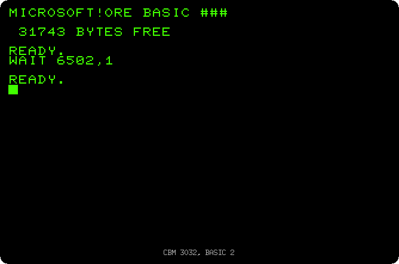

   `MICROSOFT!` over the name of Commodore. `WAIT` is a real command, it
   waits for a bit of a memory location to change, and on BASIC 1 and 4 the
   bit of 6502 never does. In BASIC 2, an address of 6502, the number of the
   processor, writes the name of Microsoft in the top left corner instead.
   The words go straight into the memory of the screen, wherever the cursor
   is, over the banner of Commodore.

   Bill Gates said in 2010 that he had put it there himself, and Commodore
   did not know about it. It was a signature, hidden where only someone who
   knew could find it. Commodore took it out again in BASIC 4, to save
   space.

10. **Clear the screen, move the cursor down a few lines and type `WAIT
    6502,10`.**

    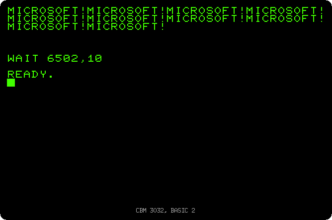

    The second number is how many times: ten `MICROSOFT!`, one after the
    other from the top left corner.

## BASIC 4

11. **Start the CBM 4032.**

    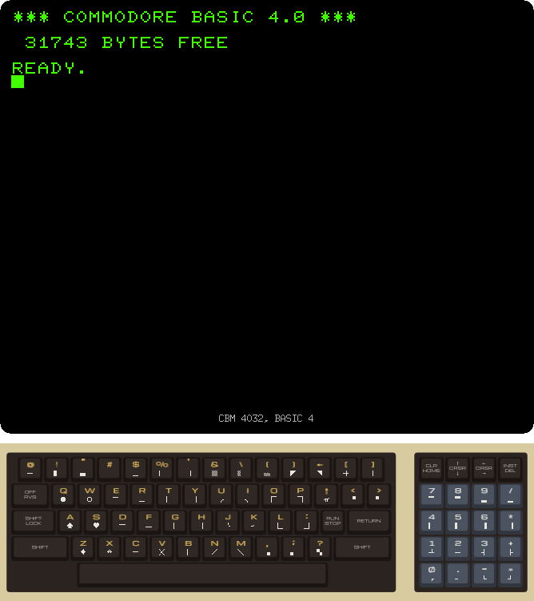

    `COMMODORE BASIC 4.0`, again with 31743 bytes free.

12. **Type `DIRECTORY`, then `PRINT DS$`.**

    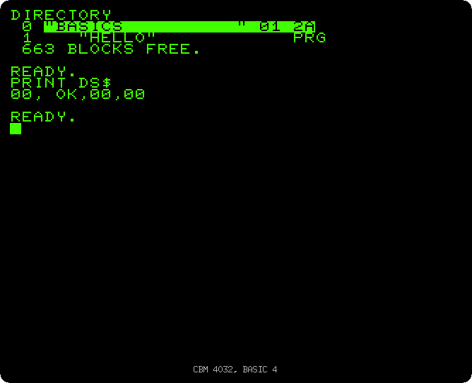

    BASIC 4 has the
    disk commands BASIC 2 was missing: `DIRECTORY` shows the directory
    without touching the program in memory, and `DS$` is the status of the
    drive, here `00, OK`. There are more, `HEADER` to format, `DSAVE`,
    `DLOAD`, `SCRATCH`; the page [The disk drive](disk.md) goes through them.

    `WAIT 6502,1` waits for good here, as on BASIC 1: the message is gone.

## How fast

13. **On each of the three, type this program and run it:**

    ```
    10 DIM A$(600):FOR I=0 TO 600:A$(I)=STR$(I):NEXT
    20 T=TI:FOR I=1 TO 1000:NEXT:PRINT "LOOP";INT((TI-T)/6)/10
    30 T=TI:X=FRE(0):PRINT "FRE(0)";INT((TI-T)/6)/10
    ```

    The first line fills an array with 600 strings. The second times an empty
    loop of 1000 turns, the third the time `FRE(0)` takes to answer, both in
    seconds: `TI` counts sixtieths of a second.

    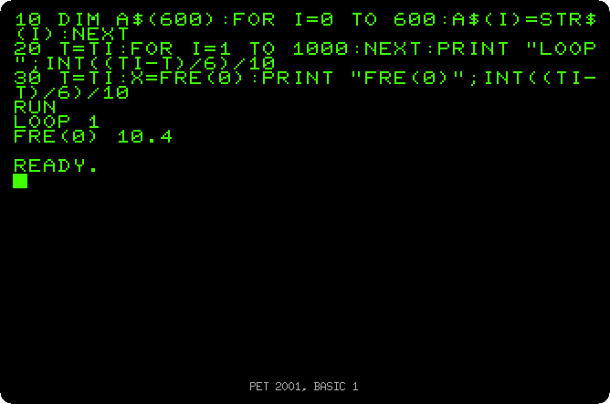

    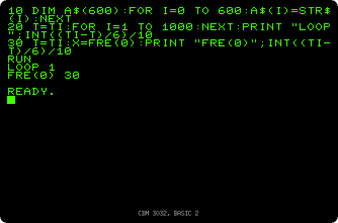

    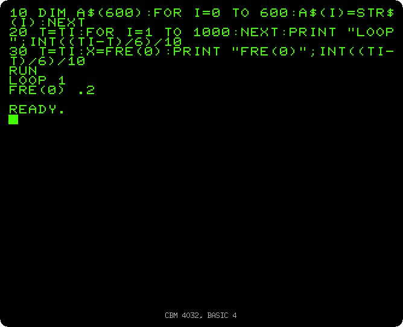

    The loop takes a second on the three: they run BASIC at the same speed.
    `FRE(0)`, the bytes free, is something else: 10.4 seconds on BASIC 1, 30
    on BASIC 2, while the PET seems frozen, and 0.2 on BASIC 4.

    The strings are kept at the top of the memory, and a string changed is
    written there anew, the old one left behind as garbage. When the memory
    is full, or `FRE` asks how much is free, BASIC packs the strings still
    in use and throws away the rest: the garbage collection. The time the
    one of BASIC 2 takes grows with the square of the number of strings:
    with 300 strings it took 7.9 seconds, with twice as many four times as
    long. A program with many strings would
    stop for minutes, at any moment. The one of BASIC 4 takes twice as long
    for twice as many strings, and is fast to begin with.

## The three side by side

| | BASIC 1 | BASIC 2 | BASIC 4 |
|---|---|---|---|
| Banner | `*** COMMODORE BASIC ***` | `### COMMODORE BASIC ###` | `*** COMMODORE BASIC 4.0 ***` |
| Models in izpet | 2001 | 3032, 3032b | 4016, 4032, 4032b, 8032 |
| Bytes free | 7167, with 8 KB | 31743, with 32 KB | 31743, with 32 KB |
| Lowercase letters | the other way round | as typed | as typed |
| Disk drives | do not work | `LOAD`, `SAVE` and `OPEN` with unit 8, commands on channel 15 | also `DIRECTORY`, `HEADER`, `DSAVE`, `DLOAD`, `SCRATCH`, `DS$` |
| Machine language monitor | no | `SYS 1024` | `SYS 1024` |
| `WAIT 6502,1` | waits for good | `MICROSOFT!` | waits for good |
| Empty loop of 1000 | 1 second | 1 second | 1 second |
| `FRE(0)` with 600 strings | 10.4 seconds | 30 seconds | 0.2 seconds |
| 80 columns | no | no | on the 8032 |

## What next

[Back to the activities](README.md), or [The disk drive](disk.md) for the
disk commands of BASIC 4.
