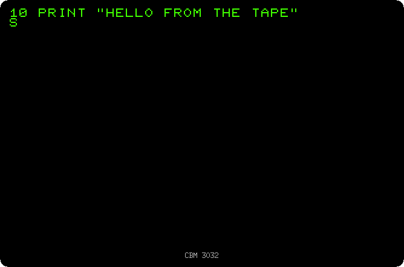
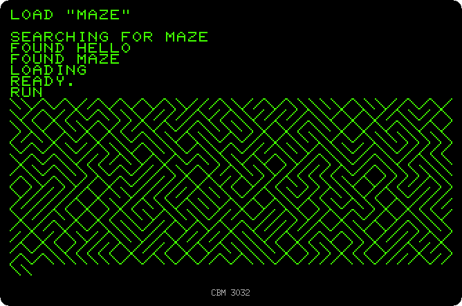

# Programs on cassette

[Back to the activities](README.md)

The PET 2001 had a cassette recorder built into its case, and the later
models plugged in an external one, the Datasette, Commodore's own. Disk drives
cost more than many PETs, so for most owners, and for schools, the cassette
was where programs were kept, swapped and bought: a tape of programs was a
software package. Saving and loading were a matter of pressing the right keys
on the recorder and waiting.

This page saves two programs on a blank tape and loads the second one back.

## What you need

Only izpet, started with a tape:

```bash
go run ./frontend/petebiten -tape mytape.tap
```

`mytape.tap` does not need to exist: a TAP file that is not there is a blank
tape, and it is written when the PET saves on it. With a tape in the
recorder, izpet has PLAY pressed, so the PET does not ask for it. While the
tape moves izpet runs as fast as it can, so the waits below are shorter than
on a real PET: the times given are the PET's.

## Saving

1. **Type a program and save it with `SAVE "HELLO"`:**

   ```basic
   10 PRINT "HELLO FROM THE TAPE"
   SAVE "HELLO"
   ```

   `WRITING HELLO` is all the PET says while the motor turns. It takes 16
   seconds for a one line program: the program is written twice, one copy
   after the other, so that a bad spot on the tape does not lose it, and each
   copy goes after a stretch of the same tone that the PET uses to find it
   when it reads the tape. The recording is five times faster.

   

2. **Type `NEW`, then the maze of [Drawing with the keyboard](drawing.md), and
   save it after the first one:**

   ```basic
   NEW
   10 PRINT CHR$(205.5+RND(1));:GOTO 10
   SAVE "MAZE"
   ```

   The tape is where the first save left it, so the maze goes after it.

## Loading

3. **Close izpet and start it again with the same tape.** A tape put in the
   recorder starts at its beginning, as if it had been rewound. Dropping the
   file of the tape on the window of izpet does the same without closing it.

4. **Type `LOAD "MAZE"`.** The PET reads the tape from the start, and says
   the name of each program it finds: `HELLO` first, which it skips, then
   `MAZE`, which it loads. It takes 29 seconds, the time to go past `HELLO`
   included. A `LOAD` with no name loads the first program it finds.

   

5. **Type `RUN`.** The maze is back.

   

## What next

[The disk drive](disk.md) does the same in a second, with a list of what is
on the disk.
