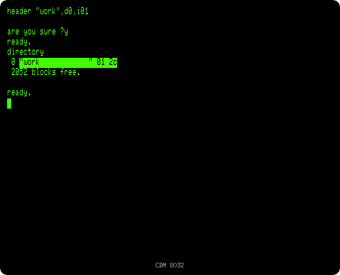
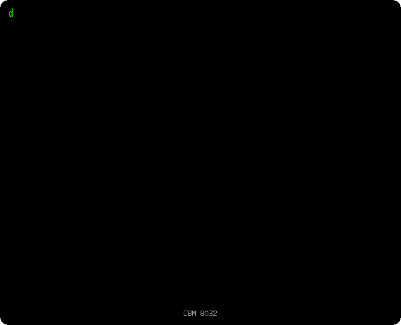
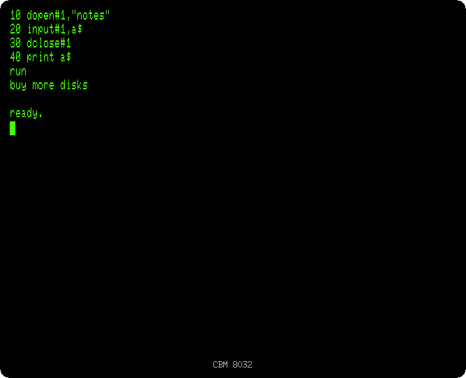
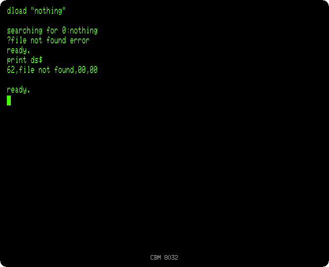
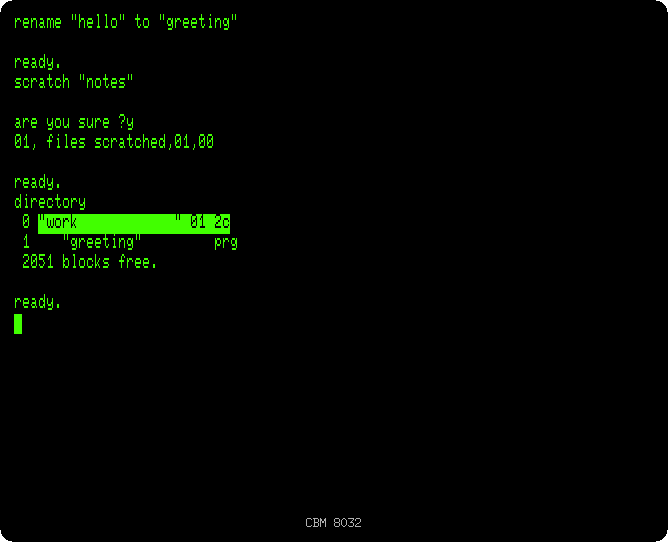
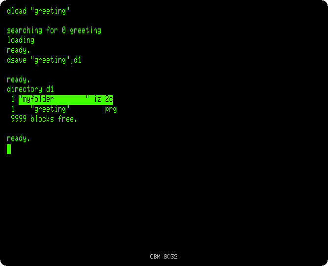

# The disk drive

[Back to the activities](README.md)

A floppy disk drive changed what a PET could be used for. A program loaded in
a second or two instead of half a minute, a disk had a directory to see what
was on it, and programs could keep data in files, read and written while they
ran: addresses, accounts, the texts of a word processor. Commodore's drives
connected to the PET by its IEEE-488 port and were small computers of their
own, with their own processor and their own DOS, so the PET only had to send
them commands.

BASIC 4 brought commands for them. This page uses them on a CBM 8032 with an
8050, a drive with two disks of about 500 KB each.

## What you need

Only izpet, started with a disk that does not exist yet, which izpet creates
when the PET writes on it, and a folder of your computer as the second disk:

```bash
mkdir myfolder
go run ./frontend/petebiten -model 8032 -disk work.d80 -disk1 myfolder
```

`-disk` puts a disk image in the drive 0, `-disk1` in the drive 1. The
extension of the file says the drive: `.d80` is an 8050 disk, `.d64` a 4040
one and `.d82` an 8250 one.

The 8032 starts with the lowercase letters, and BASIC wants its commands
typed without SHIFT, so they show in lowercase, as they are written on this
page. A letter typed with SHIFT, or with Caps Lock on, is an uppercase letter,
another character for the PET: BASIC does not know `HEADER` written with them,
and answers `?SYNTAX ERROR`, and a file name typed with them is not the same
name. `PRINT CHR$(142)`, typed without SHIFT, switches to the uppercase set,
where the letters typed without SHIFT show in uppercase.

## A new disk

1. **Format the disk with `header "work",d0,i01`, and answer `y`.** A new
   disk had to be formatted before use: `HEADER` gives it a name, `work`,
   and an id of two characters, `01`, on the drive 0. BASIC asks first,
   since formatting a disk erases what was on it.

2. **Type `directory`.** The directory of the disk, its name and id in reverse
   on top, and the space left in blocks of 254 bytes: 2052 on an empty 8050
   disk.

   

## Programs

3. **Type a program, save it with `dsave "hello"`, then `new`, `directory`,
   `dload "hello"` and `run`.**

   ```basic
   10 print "hello from the disk"
   dsave "hello"
   new
   directory
   dload "hello"
   run
   ```

   The program is in the directory, a `PRG` file of one block, and `DLOAD`
   brings it back at once.

   

## A data file

4. **Write a file from a program**, `DOPEN` with `W` to write, `PRINT#` to
   write in it, and `DCLOSE`:

   ```basic
   new
   10 dopen#1,"notes",w
   20 print#1,"buy more disks"
   30 dclose#1
   run
   ```

5. **Read it back** with `DOPEN` and `INPUT#`:

   ```basic
   new
   10 dopen#1,"notes"
   20 input#1,a$
   30 dclose#1
   40 print a$
   run
   ```

   

   `notes` is a `SEQ` file, a sequential file, read in the order it was
   written. Mailing lists, accounts and the letters of a word processor were
   kept in files like this one.

## When something goes wrong

6. **Type `dload "nothing"`, then `print ds$`.** `DS$` is the status of the
   drive, as its DOS gives it: a number, a message, and the track and sector
   where it happened. 62 is a file not found. After any disk command a
   program could look at `DS` and `DS$` to see whether it worked.

   

## Keeping the disk tidy

7. **Type `rename "hello" to "greeting"`, `scratch "notes"`, answer `y`, and
   `directory`.** `SCRATCH` deletes a file, and says how many it deleted.

   

## A folder of your computer

8. **Load the program and save it in the drive 1, then list it:**

   ```basic
   dload "greeting"
   dsave "greeting",d1
   directory d1
   ```

   The drive 1 is the folder `myfolder`, and the program is in it as
   `greeting.prg`. It is a way to take programs between izpet and your
   computer, or other emulators. Files put in the folder, `.prg` and `.seq`,
   show in the directory.

   

## What next

[The machine language monitor](monitor.md) goes under BASIC, to the
memory and the processor.
