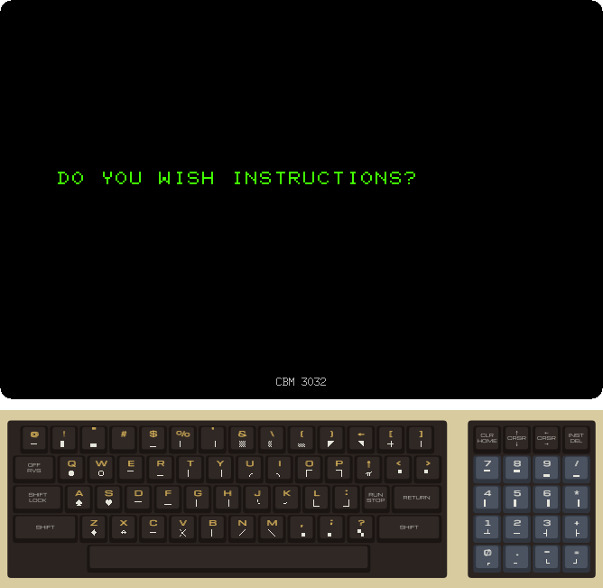
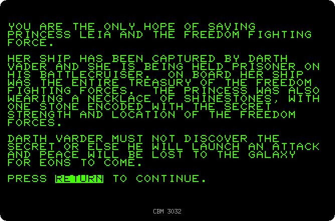
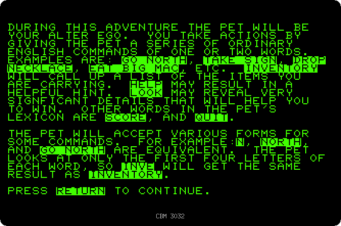
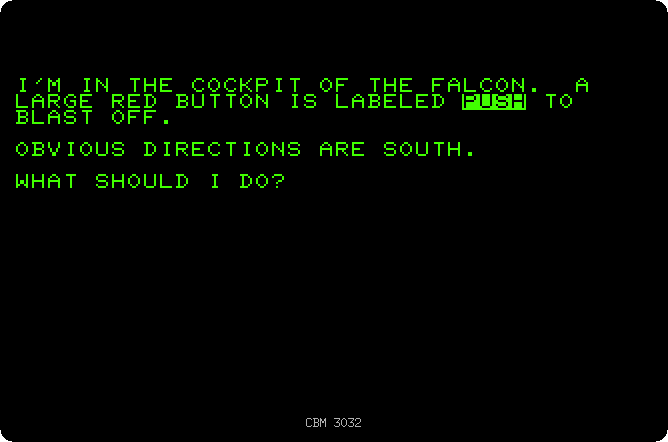
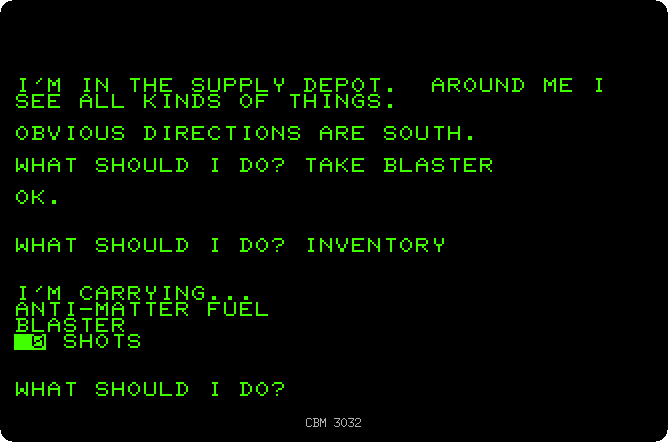
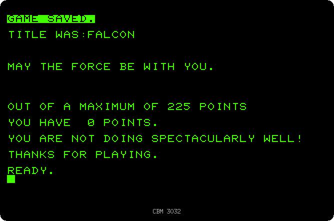
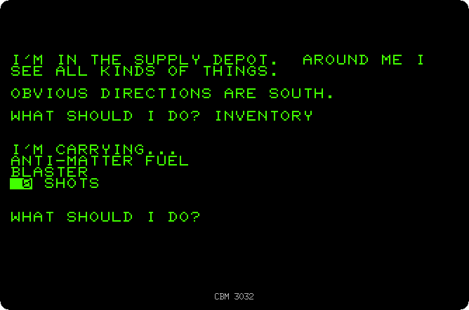

# A text adventure: Dog Star

[Back to the activities](README.md)

In a text adventure there is no picture: the computer describes where you
are, you tell it what to do in a couple of words, and it tells you what
happens. The genre started on the big computers of the universities with
Adventure, the Colossal Cave, and moved to the home computers at the end
of the seventies, often as listings in magazines that the readers typed in.

Dog Star Adventure was written by Lance Micklus for the TRS-80 and printed
in the magazine SoftSide in 1979, and adapted for the PET by David
Malmberg. You have landed on Darth Vader's battlecruiser to rescue Princess
Leia, the names borrowed from Star Wars. The whole game is a program in
BASIC, 26 kilobytes of it, too big for the PETs of 8 KB.

This page loads it from a disk, reads the story, walks off the ship, picks
up a couple of things, and saves the game on the disk to go on later.

## What you need

**`dogstar.d64`**, the disk of the game: from izpet's repository, open
[software/dogstar.d64](https://github.com/ivanizag/izpet/blob/main/software/dogstar.d64)
and click *Download raw file*. Start izpet as a 3032 with it in the drive:

```bash
go run ./frontend/petebiten -model 3032 -disk dogstar.d64
```

The game saves on the same disk, keep a copy of it if you want to start
again from a clean one.

## Starting

1. **Type `LOAD "DOGSTAR",8` and RETURN, then `RUN`.** The program takes 7
   seconds to load from the disk, and 8 more to set itself up, reading the
   rooms, the objects and the words it knows from the lines of the program,
   before it asks:

   

2. **Type `Y`.** The instructions start with the story, a page at a time,
   RETURN for the next.

   

3. **Press RETURN for the next pages.** The third says how to talk to the
   game: one or two words, a verb and a noun, of which it reads only the
   first four letters, and N, S, E, W, U and D for the directions.

   

4. **Press RETURN until the game begins.** You are in the cockpit of the
   ship you came in, and the game waits for a command.

   

## Exploring

5. **Type `S`, `D`, `S` and `E`, each with RETURN.** South to the
   passenger area, down out of the ship, south and east on the flight deck.
   Each room is described when you get in, with the things in it and the
   ways out. Each answer takes two to four seconds, the game is all in
   BASIC.

   

6. **Type `TAKE FUEL`, `E`, `N`, `TAKE BLASTER` and `INVENTORY`.** The fuel
   is on the flight deck, the blaster in the supply depot, where the game
   does not list what there is: you have to guess what to take. INVENTORY
   lists what you carry. The blaster has no shots yet.

   

   SCORE says how you are doing, and HELP may give a hint. After 25 turns,
   stormtroopers may walk in at any time, better to have something to
   shoot them with.

## Saving the game

7. **Type `SAVE` and RETURN, press RETURN twice more, then type `FALCON`
   and RETURN.** The game asks for tape or disk, D, the drive, 0, and a
   title, and the two RETURNs take the answers it offers. It writes where
   you are and what you carry in a file called `FALCON` on the disk, and
   ends.

   

8. **Type `RUN`, `N` for no instructions, then `LOAD` and RETURN, RETURN
   twice more and `FALCON` and RETURN.** The game reads the file back, and
   you are in the supply depot again, with the fuel and the blaster.

   

   A game took many evenings, and saving it on a cassette or a disk was how
   people kept going from one to the next.

## What next

[Back to the activities](README.md), or [The disk drive](disk.md) for the
disk commands of BASIC.
