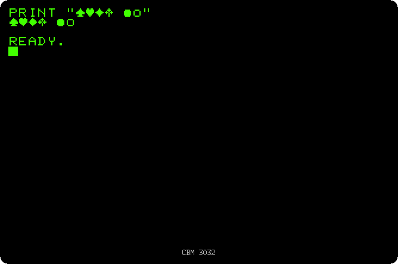
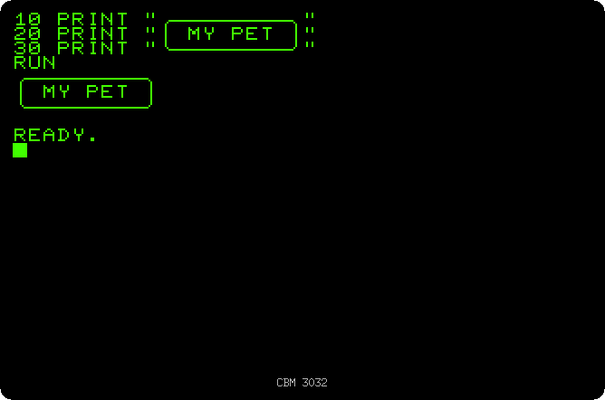
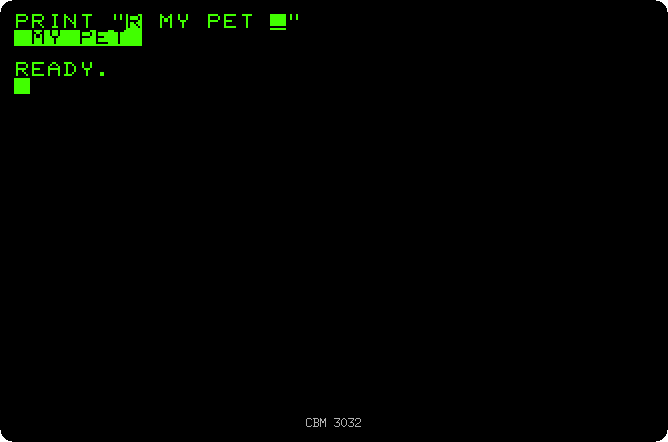
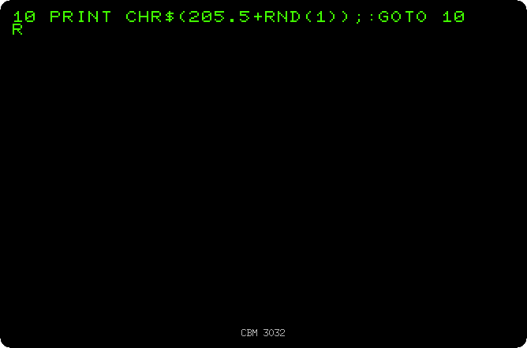
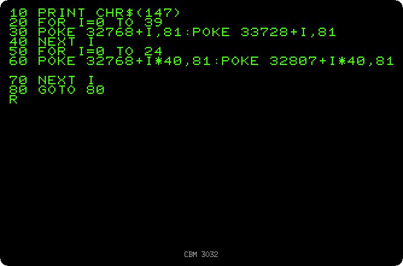

# Drawing with the keyboard

[Back to the activities](README.md)

The PET has no graphics mode: the screen shows 25 lines of 40 characters and
nothing else. What it has instead is a set of graphics characters, printed on
the front of the keys of the 2001 and of the graphics keyboard: lines,
corners, circles, the card suits, and blocks that fill a quarter or a half of
a character. They are typed with SHIFT, and with them people drew game
boards, pictures, charts and the screens of their programs, a character at a
time.

This page types the graphics characters, draws a box and a maze with them,
and puts them straight into the memory of the screen.

## What you need

Only izpet, with a model with the graphics keyboard, the 3032, the default:

```bash
go run ./frontend/petebiten
```

## The characters on the keys

1. **Type `PRINT "`, then SHIFT with A, S, Z and X, a space, SHIFT with Q and
   W, `"` and RETURN.** On a key, the letter is what it types, and the
   graphics character under it what it types with SHIFT: the spade, the
   heart, the diamond, the club, a filled circle and an empty one.

   

## A box

2. **Clear the screen with SHIFT and HOME, and type these three lines.** The
   corners are SHIFT with U, I, J and K, the lines SHIFT with @ and with ].
   Your keyboard has no SHIFT with @ or ], so click SHIFT and then the key on
   the keyboard below the screen.

   ```basic
   10 PRINT "╭────────╮"
   20 PRINT "│ MY PET │"
   30 PRINT "╰────────╯"
   ```

3. **Type `RUN`.** The listing has the box too: the graphics characters are
   kept in the program as they were typed.

   

## Reverse

4. **Type `NEW`, then `PRINT "`, press RVS, the F3 key, type ` MY PET `,
   press SHIFT and RVS, `"` and RETURN.** Inside the quotes RVS is not done
   but kept, shown as an R in reverse, and does its work when the text is
   printed: it turns reverse video on, and SHIFT and RVS, OFF, turns it off.
   A reverse space is a block, the brush of many PET pictures.

   

## A maze

5. **Clear the screen, type this line and run it:**

   ```basic
   10 PRINT CHR$(205.5+RND(1));:GOTO 10
   ```

   `CHR$(205)` and `CHR$(206)` are the two diagonals, and `RND(1)` a random
   number between 0 and 1, so the program prints one or the other at random
   for ever, and a maze comes out of them. The line is known from the
   Commodore 64, that came later with the same characters. The recording is
   four times faster than the PET: it takes about 40 seconds to fill the
   screen. Press RUN/STOP to stop it.

   

## The memory of the screen

6. **Type `NEW` and this program, and run it:**

   ```basic
   10 PRINT CHR$(147)
   20 FOR I=0 TO 39
   30 POKE 32768+I,81:POKE 33728+I,81
   40 NEXT I
   50 FOR I=0 TO 24
   60 POKE 32768+I*40,81:POKE 32807+I*40,81
   70 NEXT I
   80 GOTO 80
   ```

   The screen is 1000 bytes of memory from the address 32768, a byte per
   character, a line of 40 after the other. `POKE` writes a byte in memory,
   so the program draws a frame of circles around the screen by writing in
   it: 32768 is the top left corner, 33728 the start of the last line, 32807
   the end of the first. `CHR$(147)` clears the screen first, and line 80
   waits for RUN/STOP.

   The number of a character in the memory of the screen is not the one of
   `CHR$`: the circle is 81 on the screen, and `CHR$(81)` is the letter Q.

   

## What next

[Programs on cassette](cassette.md) keeps these programs on a tape.
