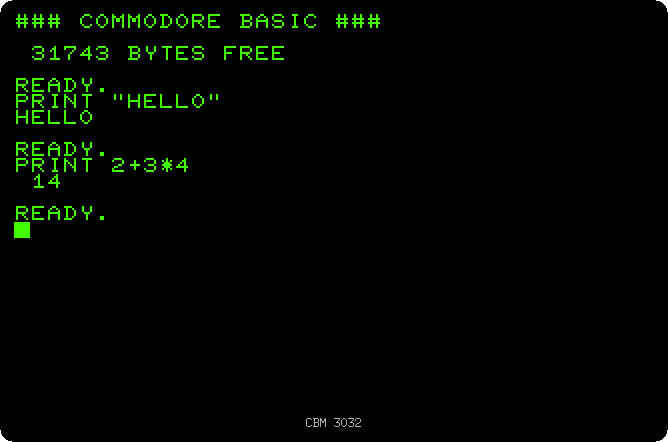
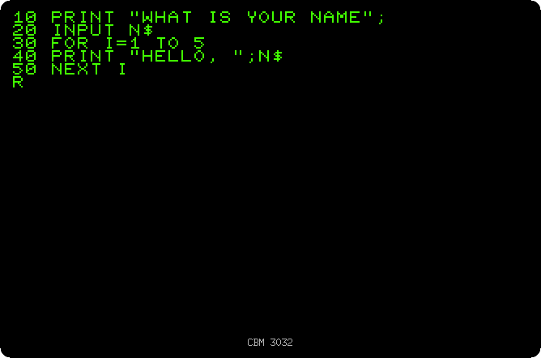
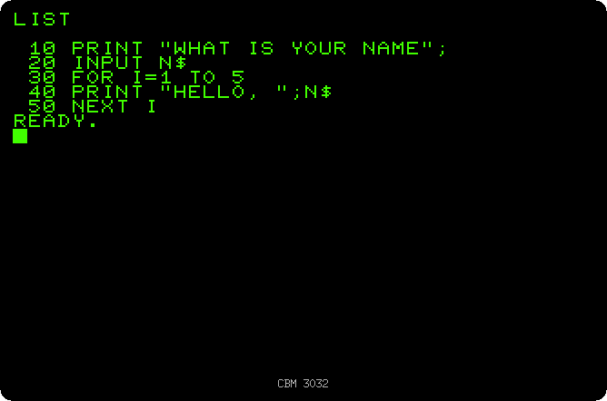
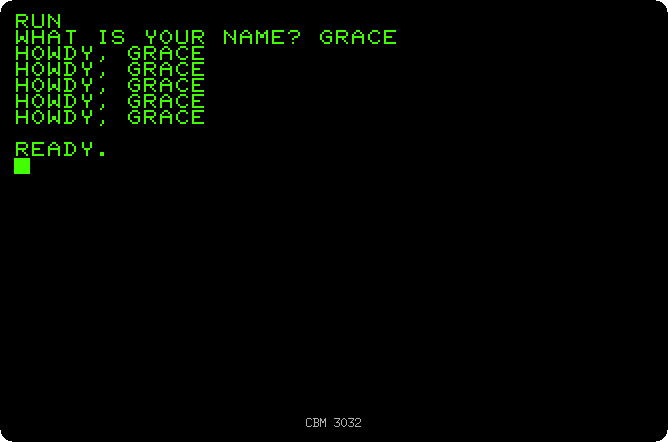
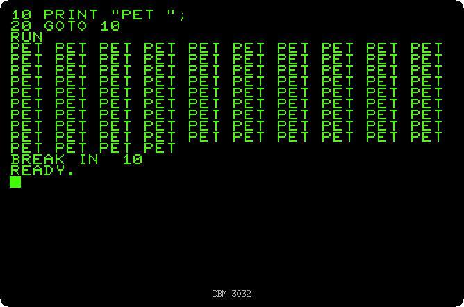

# Your first program

[Back to the activities](README.md)

A PET switched on with `READY.` and a blinking cursor, and nothing else: no
menus, no icons, no programs to choose from. Whatever the machine was going to
do, someone had to type it, and for most people who sat in front of a PET, in
a school or an office, that meant BASIC. Commodore's manuals started with
`PRINT`, and many owners never needed more than the few commands on this page
to write programs of their own.

This page types commands that run at once, then a small program, and changes
it with the screen editor, the feature that set the PET apart from most
computers of its time.

## What you need

Only izpet. The pictures are of a CBM 3032, the default model:

```bash
go run ./frontend/petebiten
```

Type as you would on your computer, the letters come out in uppercase. The
Enter key is RETURN, Escape is RUN/STOP, and the arrows move the cursor.

## Commands

1. **Type `PRINT "HELLO"` and press RETURN.** BASIC does it at once and
   writes `HELLO` under it, then `READY.` again.

2. **Type `PRINT 2+3*4` and press RETURN.** The PET is a calculator too: `14`,
   the multiplication done before the addition.

   

## A program

3. **Press SHIFT and HOME together to clear the screen, then type the
   program**, a line at a time, each ended with RETURN:

   ```basic
   10 PRINT "WHAT IS YOUR NAME";
   20 INPUT N$
   30 FOR I=1 TO 5
   40 PRINT "HELLO, ";N$
   50 NEXT I
   ```

   

   A line that starts with a number is not run: BASIC keeps it, in the order
   of the numbers, as a line of the program. They go up in tens so that a
   line can be put between two others later.

4. **Type `RUN`, and a name when it asks.** `INPUT` waits with a question
   mark for something to be typed and RETURN, and puts it in `N$`, a
   variable for text. The `FOR` and `NEXT` around line 40 repeat it five
   times.

   

5. **Clear the screen and type `LIST`.** The program is still there, as BASIC
   keeps it.

   

## The screen editor

6. **Take the cursor up to line 40, over the H of HELLO, type `HOWDY` and
   press RETURN.** On a PET what is on the screen can be changed where it is:
   RETURN reads the line the cursor is on as if it had just been typed, so
   the line 40 of the program is replaced. Many computers of the time made
   you type the whole line again, or learn the commands of a line editor.

   

7. **Run it again.**

   

## Stopping a program

8. **Type `NEW`, then this program, and run it:**

   ```basic
   10 PRINT "PET ";
   20 GOTO 10
   ```

   It writes `PET` for ever, the `GOTO` going back to line 10 each time.
   **Press RUN/STOP**, the Escape key, to stop it. BASIC says where it
   stopped, `BREAK IN 10`, and the program is still there to be listed or run
   again. `NEW` would have cleared it.

   

## What next

[Drawing with the keyboard](drawing.md) uses the graphics characters on the
keys in programs like these.
