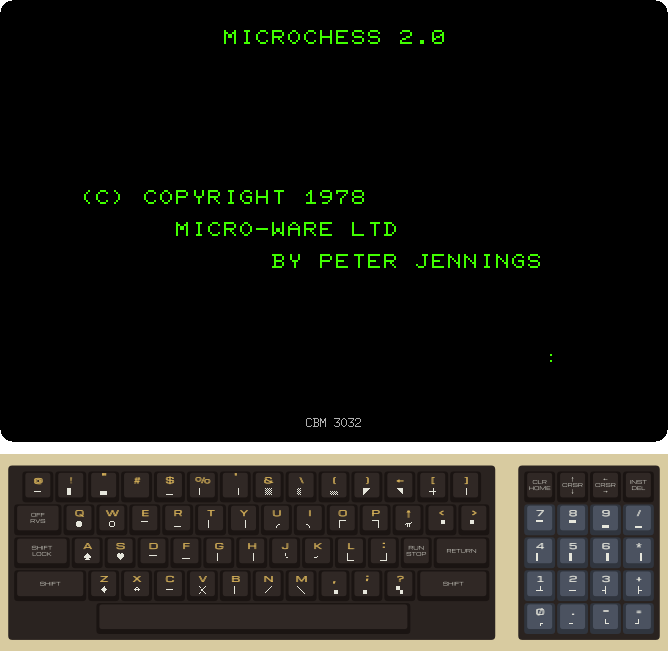
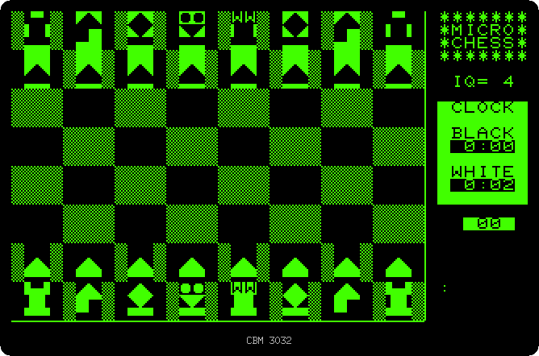
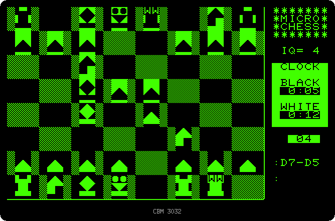
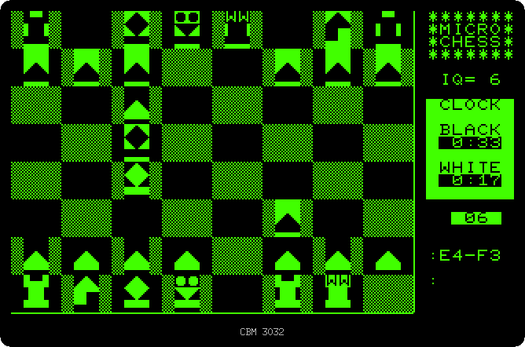

# A game of Microchess

[Back to the activities](README.md)

Microchess was written by Peter Jennings in 1976 for the KIM-1, a computer
on a single board with a hexadecimal keypad and six digits of display, and
it played chess in about a kilobyte. It was one of the first programs sold
to the owners of the new home computers, and versions followed for the
TRS-80, the Apple II and the PET. Its sales helped Jennings and Dan Fylstra,
of Personal Software, pay for the making of [VisiCalc](visicalc.md).

The version for the PET, 2.0 from 1978, draws the board with the graphics
characters, keeps a clock for each player and lets you choose how hard it
plays. This page plays the first moves of a game against it.

## What you need

**`microchess.prg`**, the program: from izpet's repository, open
[software/microchess.prg](https://github.com/ivanizag/izpet/blob/main/software/microchess.prg)
and click *Download raw file*. Start izpet as a 3032 with it:

```bash
go run ./frontend/petebiten -model 3032 microchess.prg
```

izpet puts the program in memory when BASIC is ready. It is in machine
language, it is not run with `RUN`.

## Starting

1. **Type `SYS 1039` and RETURN.** `SYS` jumps to a routine in machine
   language, here at the address 1039, where Microchess starts. The title
   waits for a command after the colon at the bottom right.

   

2. **Type `C` and RETURN.** C sets up the board. Each square is four
   characters wide and three high, the pieces drawn in them with the
   graphics characters. You play the white pieces, at the bottom, and the
   PET the black ones. On the right, the level of play, IQ 4, the clock of
   each player and the number of moves.

   

## Playing

3. **Type `E2E4` and RETURN.** A move is typed as the square the piece
   leaves and the square it goes to, the columns A to H from the left and
   the rows 1 to 8 from the bottom. The pawn of the king goes two squares
   forward. The PET thinks for two seconds and answers `E7-E5`, writing its
   move on the right and moving its pawn. The white clock stops and the
   black one runs while it thinks.

   

   A move that Microchess does not take, such as a pawn three squares
   forward, gets a question mark.

4. **Type `G1F3`, then `F1C4` and then `E1G1`, each with RETURN.** The
   knight and the bishop come out, and `E1G1` moves the king two squares,
   castling: Microchess moves the rook to the other side of the king on its
   own. The PET answers with its knight, its bishop and then `D7-D5`, a pawn
   forward that attacks the bishop and the pawn in the middle.

   

## The level of play

5. **Type `E4D5`.** The pawn takes the pawn. The PET answers `E5-E4`, eight
   seconds later, attacking the knight.

6. **Type `IQ=6` and RETURN, then `D5C6`.** The level goes from 4 to 6, out
   of 8: the higher it is, the better it plays and the longer it thinks.
   The pawn takes the knight, and the PET takes the knight back with
   `E4-F3`, after 24 seconds instead of two to eight. The clocks show the
   time each player has used, in minutes and seconds.

   

## What next

[Back to the activities](README.md), or [A budget with VisiCalc](visicalc.md),
the program Microchess helped pay for.
