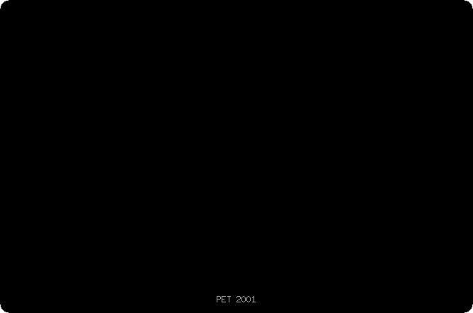
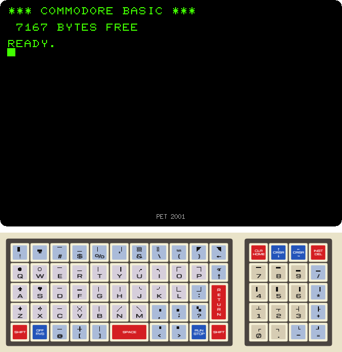
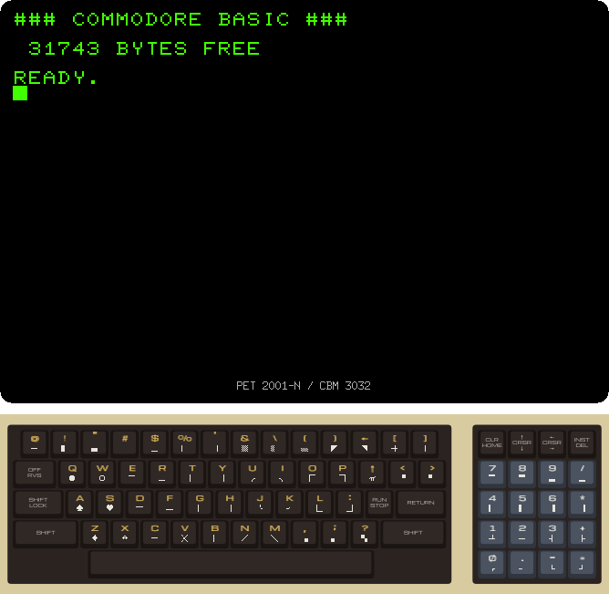
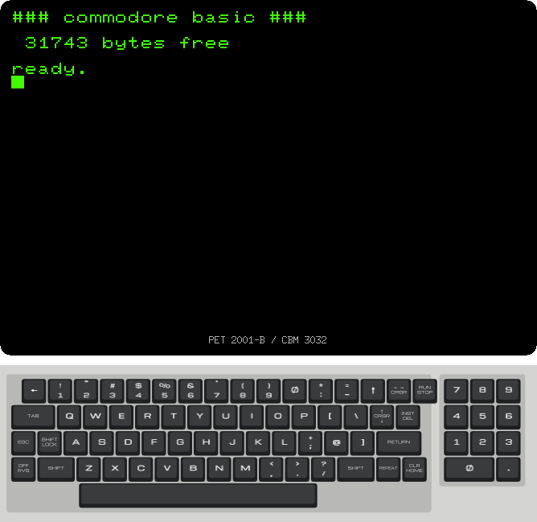
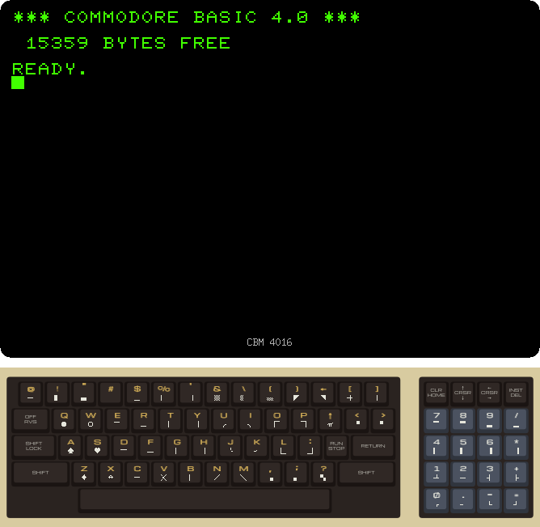
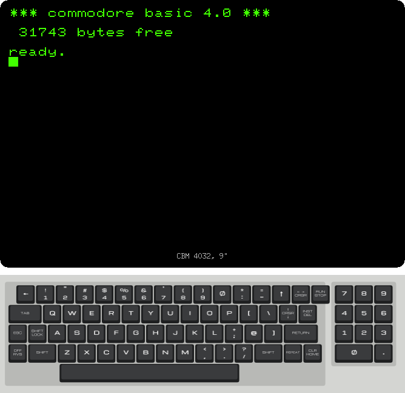
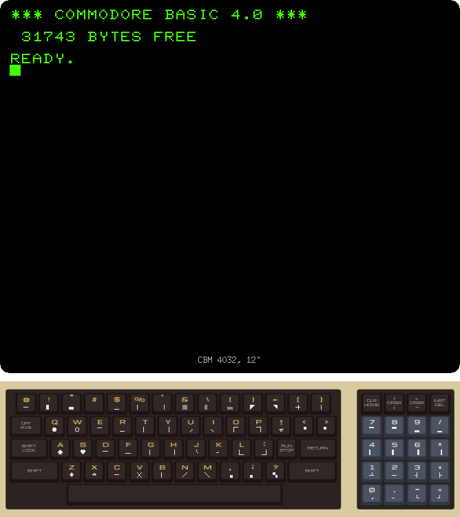
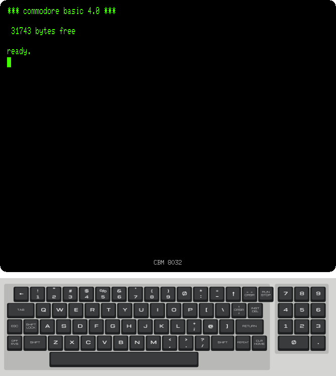

# Switching on every PET

[Back to the activities](README.md)

The PET 2001 of 1977 was one of the first computers sold ready to use: the
screen, the keyboard and a cassette recorder in one metal case, and BASIC
waiting when it was switched on. Commodore kept making PETs into the early
eighties, and the family grew in three directions: the BASIC in the ROMs,
from the first version to BASIC 4 with its disk commands; the keyboard, from
the small keys of the 2001 to the typewriter-like business keyboard; and the
screen, from 40 columns on a 9 inch monitor to 80 columns on a 12 inch one.

This page switches on the seven models izpet emulates, one after the other,
and looks at what tells them apart.

## What you need

Only izpet. The ROMs of all the models are inside it, there is nothing to
download. Each model is started with the `-model` option:

```bash
go run ./frontend/petebiten -model 2001
```

The keyboard below the screen is the one of the model. Its keys can be clicked
with the mouse, or typed on the keyboard of your computer.

## The first PET

1. **Start the PET 2001.**

   ```bash
   go run ./frontend/petebiten -model 2001
   ```

   The 2001 starts in less than half a second: the screen is cleared, the
   banner of BASIC comes up, and `READY.` with the cursor blinking under it.
   The models with more memory take longer, up to two seconds for the ones
   with 32 KB, as BASIC goes through all of it to count it.

   

   

   This is BASIC 1, the BASIC of the first PETs. `7167 BYTES FREE` is what is
   left of its 8 KB of memory once the PET takes the first kilobyte for
   itself and BASIC one byte more.

   The keyboard is the one people remember the 2001 for: small square keys in
   a grid, like a calculator's, with a numeric pad on the right. Each key
   has a graphics character over its letter, typed with SHIFT: lines, corners,
   card suits and blocks to draw with on a machine with no graphics mode.

## BASIC 2 and the graphics keyboard

2. **Start the PET 2001-N, also sold as the CBM 3032.**

   ```bash
   go run ./frontend/petebiten -model 3032
   ```

   

   The banner has `###` where the 2001 had `***`: this is BASIC 2, the
   version Commodore put in the PETs that followed the 2001. With 32 KB of
   memory, BASIC has `31743 BYTES FREE`.

   The keyboard is a full size one now, with the same arrangement as the 2001:
   the symbols on the top row, the digits on the numeric pad only, and a
   graphics character on the front of each key, under the letter in gold.

3. **Start the business version, the PET 2001-B.**

   ```bash
   go run ./frontend/petebiten -model 3032b
   ```

   

   The same BASIC, but the screen is in lowercase. The business keyboard is
   laid out like a typewriter, with the digits on the top row, TAB, ESC and
   REPEAT, and no graphics characters on its keys. Its editor ROM starts in
   the character set with lowercase letters, the one for writing letters and
   reports.

## BASIC 4

4. **Start the CBM 4016.**

   ```bash
   go run ./frontend/petebiten -model 4016
   ```

   

   `COMMODORE BASIC 4.0`: the BASIC of the later PETs, with commands for the
   disk drives, `DIRECTORY`, `DLOAD` and `DSAVE` among them. This one has 16
   KB of memory, `15359 BYTES FREE`.

5. **Start the CBM 4032 with the 9 inch screen and the business keyboard.**

   ```bash
   go run ./frontend/petebiten -model 4032b
   ```

   

   BASIC 4, 32 KB, and the business keyboard, starting in lowercase like the
   business 3032.

6. **Start the CBM 4032 with the 12 inch screen.**

   ```bash
   go run ./frontend/petebiten -model 4032
   ```

   

   The 12 inch PETs have a CRT controller, a chip that makes the picture from
   what the ROM tells it, where the older ones had the timing wired in. The
   editor ROM uses it to change the spacing of the lines with the character
   set: in the graphics set, the one it starts with, the lines touch, for the
   graphics characters to join from one line to the next; with the lowercase
   letters there is a gap between them, as easier to read.

## 80 columns

7. **Start the CBM 8032.**

   ```bash
   go run ./frontend/petebiten -model 8032
   ```

   

   80 columns of text, on the same CRT controller driving two characters at a
   time, and the business keyboard. The 8032 starts with the lowercase
   letters, and so with the gap between the lines.

## In Europe

The 12 inch models came with editor ROMs for the 50 Hz of the European mains
too. `-50hz` starts them with that ROM:

```bash
go run ./frontend/petebiten -model 8032 -50hz
```

The screen looks the same, it is redrawn 50 times a second instead of 60.

## What next

[Back to the activities](README.md), or the [README](../../README.md) for the
keys of the emulator, the disks and the tapes.
