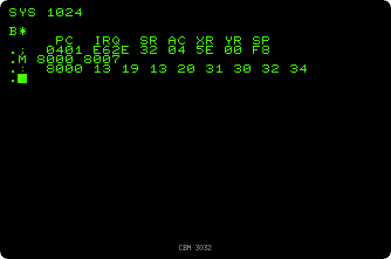
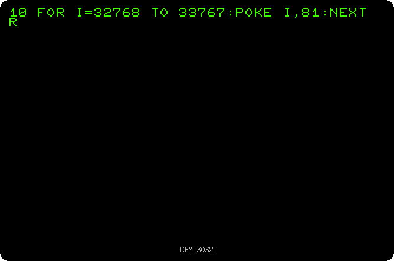

# The machine language monitor

[Back to the activities](README.md)

BASIC on a PET runs a few hundred simple statements a second, slow for games
and for anything that moves a lot of data. Under BASIC there is the 6502
processor, that runs hundreds of thousands of instructions a second, and programs that
needed speed were written for it directly, in machine language. The PETs
from the 2001-N on have a small monitor in their ROM to do that: it shows
the registers of the processor and the memory in hexadecimal, and takes new
bytes typed over them. There is no assembler in it: the instructions are
typed as the numbers they are.

This page looks at the memory with the monitor, types a routine that fills
the screen, and compares it with the same done in BASIC.

## What you need

Only izpet, with a model with BASIC 2 or 4. The pictures are of the 3032, the
default:

```bash
go run ./frontend/petebiten
```

## Into the monitor

1. **Clear the screen with SHIFT and HOME, and type `SYS 1024`.** `SYS`
   jumps to machine language at an address, and at 1024 there is a zero, the
   instruction BRK, that stops the processor and enters the monitor. It
   shows `B*`, for a break, and the registers: the program counter `PC`, the
   address the interrupts go to `IRQ`, the status `SR`, the accumulator `AC`,
   the index registers `XR` and `YR`, and the stack pointer `SP`. Its prompt
   is a dot.

2. **Type `M 8000 8007`.** `M` shows the memory from an address to another,
   eight bytes a line, in hexadecimal. `8000` is 32768, the memory of the
   screen of [Drawing with the keyboard](drawing.md): the bytes are the
   characters of the first line of the screen, `SYS 1024`. 13 is S, 19 Y,
   20 a space and 31 the digit 1.

   

## A routine

3. **Clear the screen and type these three lines**, each with two spaces after
   the colon, as the monitor writes them, and then `M 033A 0351` to look at
   what was typed:

   ```
   :  033A A2 00 A9 51 9D 00 80 9D
   :  0342 00 81 9D 00 82 9D 00 83
   :  034A E8 D0 F1 60 00 00 00 00
   M 033A 0351
   ```

   A line that starts with a colon puts its eight bytes in memory from its
   address. `033A`, 826, is the buffer of the second cassette, free while it
   is not used, a place PET programmers often put small routines in. The
   bytes are this program, written the way it would be in assembly language:

   ```
   033A  A2 00     LDX #$00     X starts at 0
   033C  A9 51     LDA #$51     A is the circle
   033E  9D 00 80  STA $8000,X  the circle in the first quarter of the screen
   0341  9D 00 81  STA $8100,X  the second
   0344  9D 00 82  STA $8200,X  the third
   0347  9D 00 83  STA $8300,X  and the fourth
   034A  E8        INX          the next position
   034B  D0 F1     BNE $033E    again, until X goes round to 0
   034D  60        RTS          back to BASIC
   ```

   

4. **Type `X`** to leave the monitor, back to BASIC.

## BASIC against machine language

5. **Fill the screen with circles in BASIC:**

   ```basic
   NEW
   10 FOR I=32768 TO 33767:POKE I,81:NEXT
   RUN
   ```

   It takes five seconds, the circles coming in line after line.

   

6. **Clear the screen and type `SYS 826`.** The routine does the same in
   less than a hundredth of a second: 256 turns of a loop of 25 cycles of the
   processor, at a million cycles a second. Eight hundred times faster than
   BASIC.

   

## What next

[Back to the activities](README.md), or [The disk drive](disk.md) to keep
programs on a disk.
