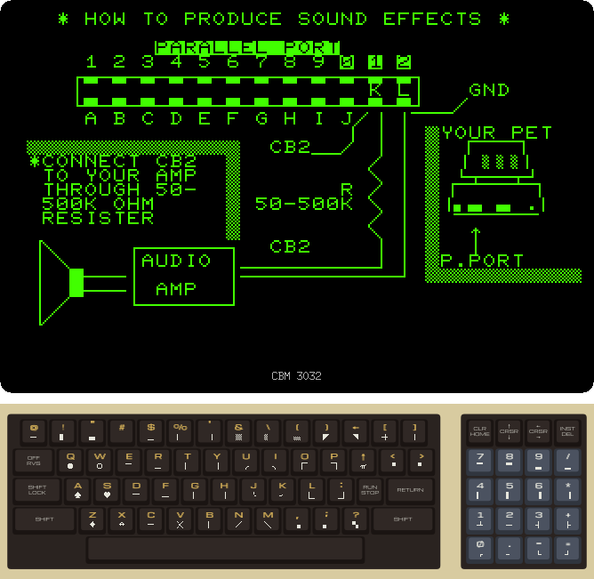
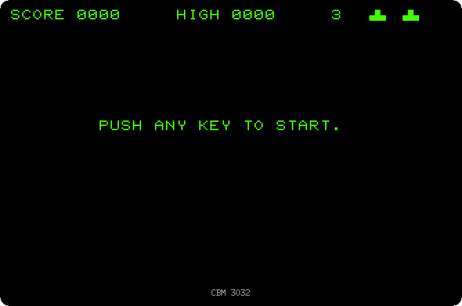
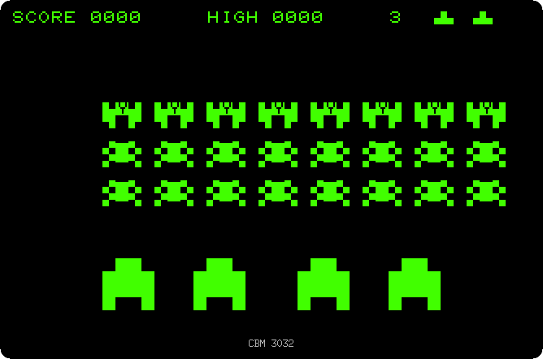

# Playing Space Invaders

[Back to the activities](README.md)

Space Invaders came out in the arcades in 1978, by Taito, and soon everyone
who had a computer wanted it at home. The PET had no graphics mode, no
sprites and no sound chip, yet within a couple of years there were many
Space Invaders for it, sold on cassette, swapped at user groups and typed in
from magazines. The invaders, the bases and the ship are drawn with the
graphics characters, two or three of them each, and the sound comes out of a
single line of the user port.

This page plays one of them on a 3032: the screen that tells how to hear it,
the title and its demo, and a game. The copy has no name of its author.

## What you need

**`space-invaders.prg`**, the game: from izpet's repository, open
[software/space-invaders.prg](https://github.com/ivanizag/izpet/blob/main/software/space-invaders.prg)
and click *Download raw file*. Start izpet as a 3032 with it:

```bash
go run ./frontend/petebiten -model 3032 space-invaders.prg
```

izpet loads the program when BASIC is ready and runs it.

## The title

1. **Start izpet with the game.** The first screen is not the game, it is
   how to hear it. The PET 2001 and the 3032 have no speaker: the programs
   that made sound did it on the line CB2 of the user port, the connector at
   the back, and the owner wired an amplifier to it, through a resistor, as
   drawn here. izpet plays CB2 on your speakers, nothing to wire.

   

   The game is played with the keys of the numeric pad, on the right of the
   keyboard: 4 moves the ship to the left, 6 to the right, and A, on the
   left, fires. On a modern keyboard they are 4, 6 and A of the main keys.

2. **Press any key.** The title is written letter by letter, the table of
   points of each invader under it, and an invader comes to fix a letter of
   PLAY. After about 20 seconds the invaders start a game on their own, the
   demo, that goes on until a key is pressed.

   

3. **Press a key.** The demo stops and the game waits.

   

## The game

4. **Press a key, and play: 4 and 6 to move, A to fire.** Five rows of
   eight invaders march from side to side, slowly coming lower, and drop
   bombs. The four bases shelter the ship, and are worn
   away by the bombs and by its own shots. Each invader is worth 10, 20 or
   30 points, by its row, as the table of the title says. Three ships, the
   number on the top right, the ships left drawn next to it.

   

   The recording plays at the speed of the game, 20 seconds of it. The
   invaders move by whole characters, eight pixels at a time, the only way
   with no graphics mode; changing the character of an invader on each step
   is what makes them walk.

## What next

[Back to the activities](README.md), or [Drawing with the keyboard](drawing.md)
for the graphics characters the game is made of.
