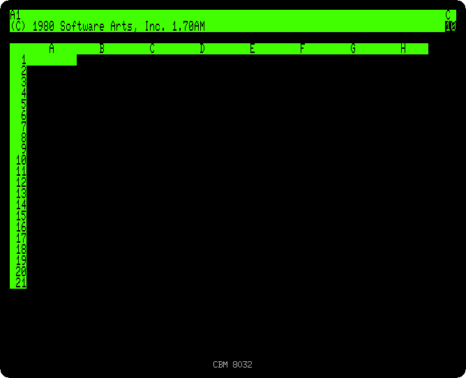
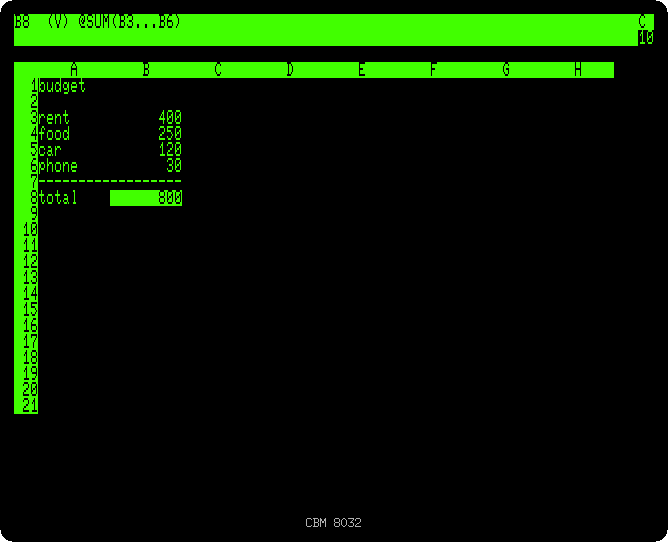
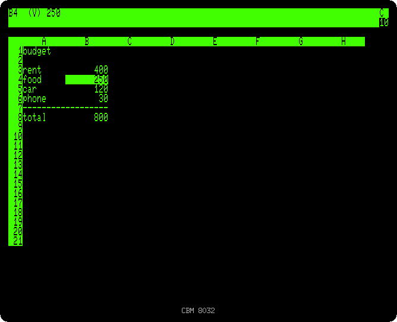

# A budget with VisiCalc

[Back to the activities](README.md)

VisiCalc, by Dan Bricklin and Bob Frankston of Software Arts, was the first
spreadsheet: a grid of cells where a number can be the sum or the result of
other cells, recalculated as soon as any of them changes. What took an
accountant an evening with paper, pencil and a calculator, trying what
happens if a cost goes up, took a few keys. It came out for the Apple II in
1979 and for the PET soon after, and it is often called the first program
people bought a computer for.

This page makes a small budget with VisiCalc, changes a cost, saves the sheet
on a disk and prints it.

## What you need

**`visicalc.d64`**, the VisiCalc disk: from izpet's repository, open
[software/visicalc.d64](https://github.com/ivanizag/izpet/blob/main/software/visicalc.d64)
and click *Download raw file*. The original VisiCalc for the PET would not
run without a chip that came with it, this disk has versions that do not
need it. Start izpet as an 8032 with it in the drive 0, a new disk in the
drive 1 and a printer:

```bash
go run ./frontend/petebiten -model 8032 -disk visicalc.d64 -disk1 sheets.d64 -printer printed.txt
```

`sheets.d64` and `printed.txt` do not need to exist.

## Starting VisiCalc

1. **Load and run the loader:**

   ```basic
   DLOAD "VC*"
   RUN
   ```

   The loader reads VisiCalc for 80 columns from the disk, about 20 seconds,
   and starts it. The sheet has columns A, B, C... and rows 1, 2, 3..., and a
   cell is named by both, A1 the top left one, where the cursor is. The two
   lines on top are VisiCalc's: the cell, its type and its contents, and
   under it the line where the commands ask their questions.

   

## The budget

2. **Go to a cell with `>` and its name, type what goes in it and press
   RETURN**, for each of these:

   | Go to | Type |
   |---|---|
   | `>A1` | `budget` |
   | `>A3` | `rent` |
   | `>B3` | `400` |
   | `>A4` | `food` |
   | `>B4` | `250` |
   | `>A5` | `car` |
   | `>B5` | `120` |
   | `>A6` | `phone` |
   | `>B6` | `30` |
   | `>A8` | `total` |
   | `>B8` | `@sum(b3.b6)` |

   What starts with a letter is a label, a text; what starts with a digit or
   `@` is a value. `@SUM(B3...B6)` is the sum of the cells from B3 to B6, the
   period typed between them shown as three. The arrow keys move the cursor
   too.

3. **Go to `>A7`, type `/--` and RETURN, and the same in `>B7`.** `/-` makes
   a label that repeats what follows across the whole cell, here a line under
   the costs.

   

## What if

4. **Go to `>B4`, type `300` and press RETURN.** The food goes up, and the
   total with it, at once: every value that depends on B4 is calculated
   again.

   

## Saving and printing

5. **Type `/S`.** The commands start with `/`, and each asks for the next
   letter on the second line: `/S` is storage, with `L` to load, `S` to
   save, `D` to delete, `I` to initialize a disk, `Q` to quit VisiCalc and
   `#` for files other programs could read.

   

6. **Type `S`, then `1:budget.vc` and RETURN.** The sheet is saved on the
   drive 1, as a file `budget.vc`.

7. **Go to `>A1`, type `/PP`, `B8` and RETURN.** `/P` prints from the cell
   of the cursor to the one typed, here A1 to B8, on a PET printer, the
   second `P`. izpet's printer writes it to `printed.txt`:

   ```
   budget

   rent           400
   food           300
   car            120
   phone           30
   ------------------
   total          850
   ```

## What next

[Writing a letter with WordPro](wordpro.md), the other program of the PET in
the office, or [back to the activities](README.md).
