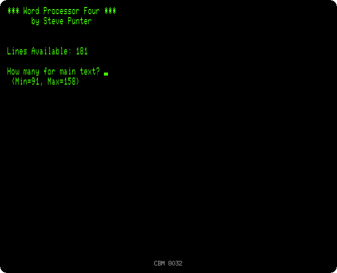
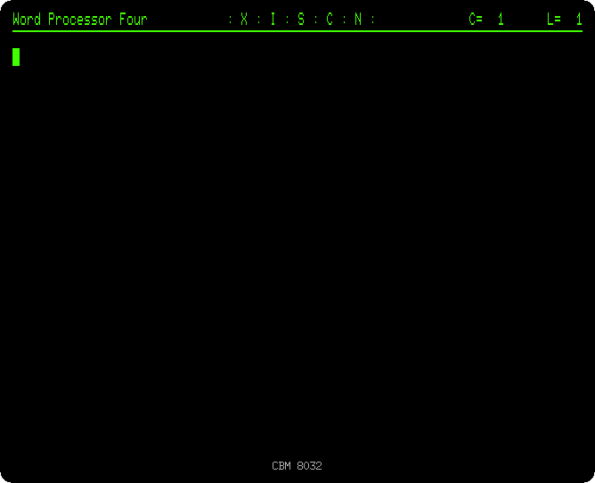
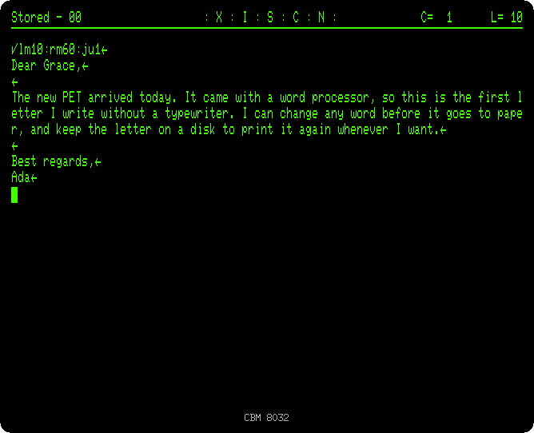
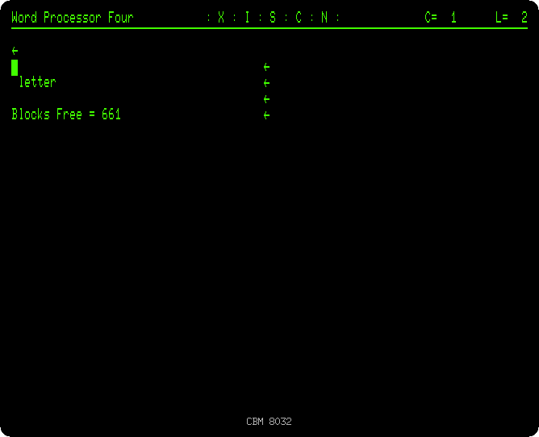
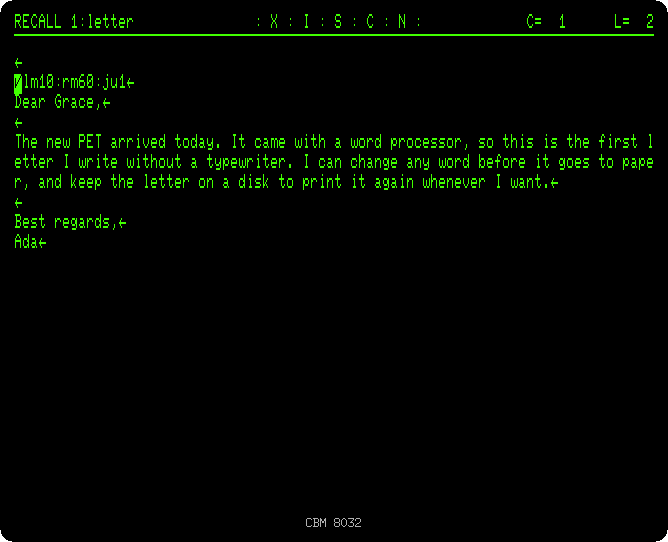

# Writing a letter with WordPro

[Back to the activities](README.md)

Word processing was one of the first reasons for a business to buy a
computer: a letter could be corrected before it was printed, kept, and
printed again, where a typewriter meant typing it all again. On the PET the
best known word processor was WordPro, by Steve Punter, and the 8032, with
its 80 columns, its lowercase and its typewriter keyboard, was the PET made
for it.

This page writes a letter with WordPro 4, keeps it on a disk, and prints it.

## What you need

**`wordpro4.d64`**, the WordPro disk: from izpet's repository, open
[software/wordpro4.d64](https://github.com/ivanizag/izpet/blob/main/software/wordpro4.d64)
and click *Download raw file*. Start izpet as an 8032 with it in the drive 0,
a new disk for the letters in the drive 1 and a printer:

```bash
go run ./frontend/petebiten -model 8032 -disk wordpro4.d64 -disk1 letters.d64 -printer printed.txt
```

`letters.d64` and `printed.txt` do not need to exist: the disk is created
when WordPro writes on it, and the file when something is printed.

The 8032 starts with the lowercase letters: type the commands and keys of
this page without SHIFT, as they are written here. A letter typed with SHIFT,
or with Caps Lock on, is an uppercase letter, another character for the PET.

WordPro uses the OFF/RVS key as a control key, the F3 key in izpet: it is
pressed, and let go, before the key of a command.

## Starting WordPro

1. **Load and run it:**

   ```basic
   dload "wordpro 4"
   run
   ```

   WordPro asks how much of the memory to use for the main text, in lines.
   The rest is the extra text, a second area for pieces of text to copy
   around.

   

2. **Answer the questions:** `150` and RETURN for the main text, RETURN for
   the printer on the device 4, `p` for a Commodore printer, and RETURN for
   the disk drive on the device 8.

## The letter

3. **Press OFF/RVS and `/`, type `lm10:rm60:ju1` and RETURN.** OFF/RVS and
   `/` put a check mark at the start of the line, which makes it a format
   line: not printed, but read as commands for the printing. `lm10` sets the
   left margin at 10, `rm60` the right one at 60, and `ju1` justifies the
   text, spreading the words of each line to fill it.

4. **Type the letter**, with RETURN only at the end of each paragraph:

   ```
   Dear Grace,

   The new PET arrived today. It came with a word processor, so this is
   the first letter I write without a typewriter. I can change any word
   before it goes to paper, and keep the letter on a disk to print it
   again whenever I want.

   Best regards,
   Ada
   ```

   The capitals of the letter are typed with SHIFT, as on a typewriter. The
   arrow `←` marks where RETURN was pressed. WordPro does not wrap the
   words on the screen: the lines of the screen are cut at 80 columns, and
   the paragraphs are made into lines of the width of the paper when it
   prints. The status line, on top, has the column and the line of the
   cursor, `C=` and `L=`.

   

## Keeping it on the disk

5. **Press SHIFT and CLR/HOME, `m`, `1`, type `letter` and press RETURN.**
   SHIFT and CLR/HOME is the key of the disk commands, `m` memorizes, saves,
   the text, on the drive 1. The status line says `Stored - 00`, the error
   status of the drive: 00 is no error.

   

6. **Press OFF/RVS, `1` and RETURN.** The directory of the drive 1. It takes
   the place of the text, which is why the letter was stored first.

   

7. **Press SHIFT and CLR/HOME, `r`, type `1:letter` and press RETURN.** `r`
   recalls, loads, a text, with the drive written before its name.

   

## Printing

8. **Press OFF/RVS, `o` and RETURN.** `o` sends the text to the printer, and
   izpet's writes what it prints to `printed.txt`:

   ```
            Dear Grace,

            The new PET arrived today.  It  came  with  a  word
            processor, so this is  the  first  letter  I  write
            without a typewriter. I can change any word  before
            it goes to paper, and keep the letter on a disk  to
            print it again whenever I want.

            Best regards,
            Ada
   ```

   The margins and the justification of the format line, done by WordPro as
   it printed.

## What next

[VisiCalc](visicalc.md), the other program that sold computers to
businesses.
